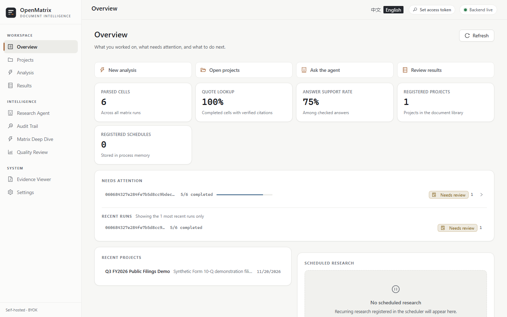
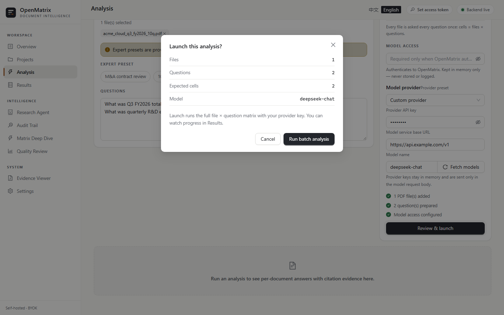
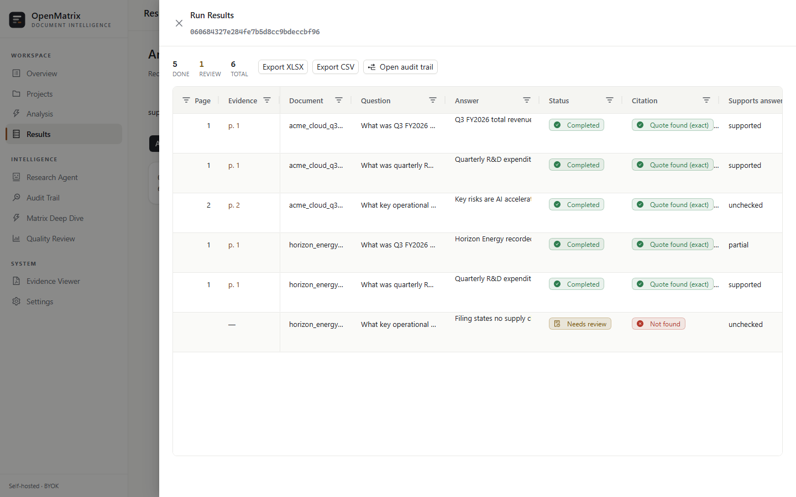
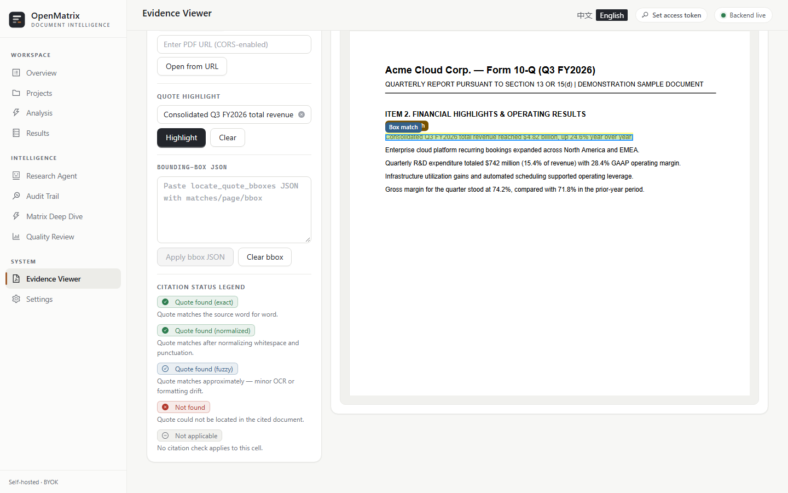
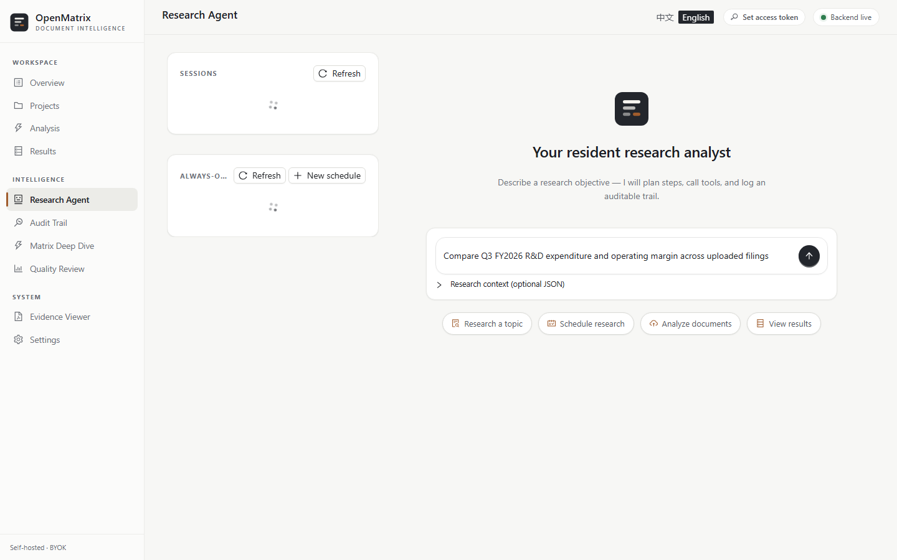

# OpenMatrix

**A self-hosted, evidence-first AI research desk that keeps every important answer connected to verifiable source evidence.**

[中文](README.zh-CN.md) | English

> **Independent open-source project:** OpenMatrix is an independent, self-hosted research desk (Apache-2.0). It is not affiliated with, endorsed by, or maintained by any commercial research vendor.

[](LICENSE)


OpenMatrix turns filings, financial reports, research documents, and public data into reviewable research outputs with verbatim source quotes, physical page references, answer-support checks, and an observable execution trail.

It is built for workflows where a fluent answer is not enough. Analysts need to know:

- **Where did this claim come from?**
- **Does the cited quote actually support the numbers and conclusions in the answer?**
- **What failed or still needs human review?**
- **Can the output become a clean report, spreadsheet, or citation-footnoted slide deck?**

> **Release status (`v0.1.0` Public Preview):** Ready for local evaluation, self-hosted team pilots, and MCP integration. See [Security Policy](SECURITY.md) for deployment hardening defaults and [Patent and Compliance Notice](#patent-and-compliance-notice) before commercial SaaS deployment.



_Screenshot from a local verification environment using demonstration data. Values such as cell counts and verification rates are not customer or general accuracy claims._

## Why OpenMatrix

Most AI document tools optimize for generating fluent prose. OpenMatrix optimizes for producing **auditable work that can be checked**.

### Evidence before confidence

Every answer can carry its supporting verbatim quote, document source, physical page number, quote verification status (`verified_exact` / `verified_normalized` / `verified_fuzzy` / `not_found`), and **answer-support assessment** (`supported` / `partial` / `unsupported`). Missing or unsupported citations are surfaced as `needs_review` instead of being silently presented as facts.

### Recommended grid-free research workflow

For multi-document and recurring research pipelines, OpenMatrix recommends its grid-free **Document List + Structured Q&A + Evidence Summary** workflow (`analyze_documents` via MCP/API and the Research Agent console):

- Create document projects, retrieve across sources, run bounded research plans, inspect step outputs, jump directly to highlighted PDF pages, and export deliverables to CSV, XLSX, PDF, DOCX, or PPTX.

### Self-hosted and bring-your-own-model (BYOK)

Run locally or on private infrastructure with any OpenAI-compatible model endpoint (OpenAI, DeepSeek, local vLLM/llama.cpp, or internal gateways). Provider credentials remain user supplied; the Research Desk never persists provider API keys in browser storage.

### Honest system behavior

OpenMatrix explicitly distinguishes `completed`, `failed`, `unavailable`, and `needs_review` states. The UI never fabricates conclusions, hidden reasoning, or fake progress when the backend has not produced them.

## Designed For

OpenMatrix is well suited for workflows such as:

- Reviewing company 10-K/annual filings and regulatory disclosures
- Extracting financial and operating KPIs with unit/scale normalization and source citations
- Comparing claims and spotting contradictions across multiple documents
- Building evidence-backed research memos and executive briefs
- Turning verified research outputs into CSV, XLSX, PDF, DOCX, or PPTX slide decks
- Orchestrating repeatable research tasks over REST API or 52 MCP tools

### Interested in a controlled pilot?

A productive pilot starts with one repeatable research task, public or safely de-identified filings, and a domain reviewer who can evaluate output quality. Open an issue using the **Pilot** template (`Pilot: <your workflow>`) in [GitHub Issues](https://github.com/xw371242806-afk/openmatrix/issues), or email [ste455525@gmail.com](mailto:ste455525@gmail.com) directly for private pilots, partnerships, and collaboration inquiries.

Do not post confidential documents, credentials, personal data, or regulated information in public issues.

## Research Workflow

```text
Documents & public filings (PDF / DOCX / TXT / SEC EDGAR / AkShare / FRED)
        ↓
Parse, preserve physical pages, index & retrieve (BM25 / optional hybrid)
        ↓
Structured analysis & bounded Agent orchestration (52 MCP tools)
        ↓
Quote verification + Answer-support checking (numeric & entity grounding)
        ↓
Evidence PDF viewer (jump-to-page + highlight) & execution audit trace
        ↓
Export deliverables (CSV / XLSX / PDF / DOCX / PPTX with citation footnotes)
```

## Product Tour

### Analyze documents with an explicit readiness check

Select documents, define questions, configure model access, verify readiness, and run only when required inputs are valid.



### Inspect answers instead of trusting a black box

Review run status, verified quotes, answer-support signals, physical page numbers, and export options from one workspace.



### Jump back to the original PDF page

Use the Evidence Viewer to inspect the cited page, verbatim quotation, verification status, and available bounding-box highlights.



### Trace every step of the Research Agent

Run bounded multi-step research tasks, inspect tool steps and terminal states, and keep unavailable outputs explicitly unavailable.



## Core Capabilities

| Area | Availability and capabilities |
|---|---|
| Document parsing | **Default:** PDF ingestion, multi-document analysis, `pypdf` & `pdfplumber` physical-page extraction, DOCX/TXT uploads. **Optional:** Camelot tables, OCRmyPDF / PaddleOCR |
| Retrieval | **Default:** Page-aware BM25 (`bm25s`) with financial query expansion. **Optional:** dense/hybrid retrieval and reranking |
| Verification | Exact/normalized/fuzzy quote verification, raised PDF footnote handling, numeric/unit `assess_answer_support`, `extract_kpis` scale normalization |
| Agent & MCP | 52 FastMCP tools, rule-based planner, opt-in LLM planner (`OPENMATRIX_LLM_PLANNER`), interruptible `research_run`, persistent schedules (SQLite) |
| Data sources | **Key-free defaults:** SEC EDGAR (annual FY XBRL + `www.sec.gov/Archives` filing chunks), project docs, SSRF-hardened URL fetch. **Optional:** AkShare, FRED, web search |
| Delivery | **REST & UI:** CSV, XLSX, PDF, DOCX, PPTX. **MCP tools:** `export_report`, `export_slides` (citation-footnoted PowerPoint) |
| Storage | **Default:** SQLite + local disk (`data/`). **Optional production backends:** PostgreSQL (`psycopg`) + S3/MinIO (`boto3`) |
| Security | `OPENMATRIX_ENABLE_AUTH=auto` (enforces Bearer auth automatically when binding beyond loopback), strict CORS, credential redaction, SSRF IP pinning, streaming upload limits |

See the [Documentation Index](docs/README.md), [MCP Client Guide](docs/MCP-CLIENTS.md), [MCP Roadmap](docs/MCP-ROADMAP.md), and [Security Policy](SECURITY.md).

## Quick Start

### Docker (Recommended)

The default Compose stack binds to `127.0.0.1` and uses SQLite + local disk (`openmatrix-data` volume), requiring no external database.

```bash
docker compose up --build
```

Open:

```text
http://localhost:8000/ui/
```

When authentication is enabled (automatically on non-loopback hosts such as `0.0.0.0` inside containers), inspect the generated master key with:

```bash
docker compose exec app cat /data/master_key.txt
```

### Local Development

Requirements:

- Python 3.12+
- Node.js 24+

Build the React Research Desk:

```bash
cd ui
npm ci
npm run build
cd ..
```

Start on macOS / Linux:

```bash
python -m venv venv
./venv/bin/python -m pip install -r requirements.txt -c requirements.lock
./venv/bin/python main.py
```

Start on Windows PowerShell (or run `start.bat` / `setup_windows.ps1` for cached one-click startup):

```powershell
python -m venv venv
.\venv\Scripts\python.exe -m pip install -r requirements.txt -c requirements.lock
.\venv\Scripts\python.exe main.py
```

Open `http://localhost:8000/ui/`.

The legacy zero-dependency UI remains available at `http://localhost:8000/static/index.html`.

## Model Access

OpenMatrix works with any OpenAI-compatible chat completions endpoint. Credentials are supplied at runtime via the UI (kept in memory only) or server environment variables (`OPENMATRIX_LLM_API_KEY`, `OPENMATRIX_LLM_BASE_URL`, or `OPENAI_*`).

Supported patterns:

- Cloud OpenAI-compatible providers (e.g., OpenAI, DeepSeek, OpenCode Go, internal API proxies)
- Self-hosted local model servers (e.g., `vLLM`, `llama.cpp`, Ollama OpenAI-compatible endpoints)
- Task-specific model routing (`OPENMATRIX_ROUTER_ENABLED` via `model_router.py`)
- Deterministic mock server (`scripts/mock_openai.py`) for CI/testing only

## Verification

Run the Python test suite:

```bash
python -m pytest -q
```

Run frontend checks:

```bash
cd ui
npm test
npm run lint
npm run build
```

With the service running on `127.0.0.1:8000`, run the service E2E smoke test:

```bash
python scripts/verify_running_service.py
```

## What OpenMatrix Does Not Claim

- It is not a substitute for professional investment, legal, compliance, or accounting judgment.
- A verified quotation proves the text appears in the source; analysts should still review broader context and `support_status`.
- It does not claim SOC 2, ISO 27001, or other formal enterprise compliance certifications out of the box.

## Patent and Compliance Notice

OpenMatrix is an independent implementation licensed under the [Apache License 2.0](LICENSE). Open-source licenses grant copyright and patent rights from contributors to the OpenMatrix codebase itself, **not** freedom-to-operate (FTO) licenses under third-party patents.

- For multi-document workflows, OpenMatrix recommends the grid-free **`analyze_documents`** (document list + independent Q&A + structured summary) pattern and **strictly excludes** attention-score-to-cell-score highlighting.
- The codebase also retains a matrix table view and multi-document execution paths for local evaluation. Prior to commercial SaaS deployment—particularly in the United States—organizations should conduct qualified patent counsel review against applicable third-party claims. See [PATENT_COMPLIANCE.md](PATENT_COMPLIANCE.md) for engineering guardrails.

## Contributing

We welcome bug reports, documentation improvements, and pull requests! See [CONTRIBUTING.md](CONTRIBUTING.md), [CODE_OF_CONDUCT.md](CODE_OF_CONDUCT.md), [SECURITY.md](SECURITY.md), and [THIRD_PARTY_NOTICES.md](THIRD_PARTY_NOTICES.md).

## Contact & Collaboration

- **Email (pilots, partnerships, collaboration):** [ste455525@gmail.com](mailto:ste455525@gmail.com)
- **Bug reports & feature requests:** [GitHub Issues](https://github.com/xw371242806-afk/openmatrix/issues)
- **General Q&A & ideas:** [GitHub Discussions](https://github.com/xw371242806-afk/openmatrix/discussions)

## License

Licensed under the [Apache License 2.0](LICENSE).
