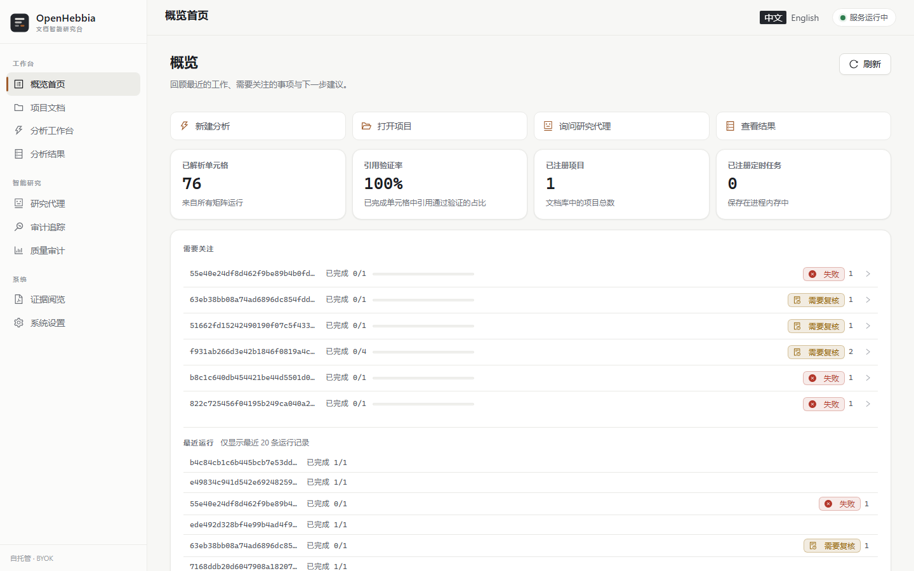
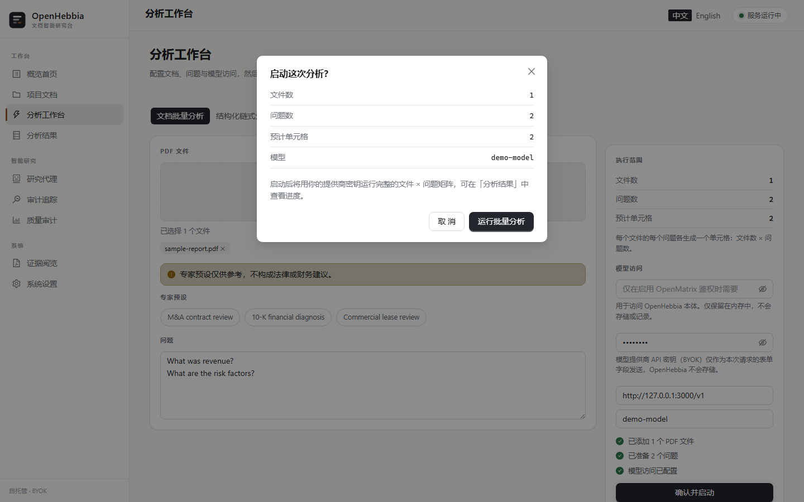
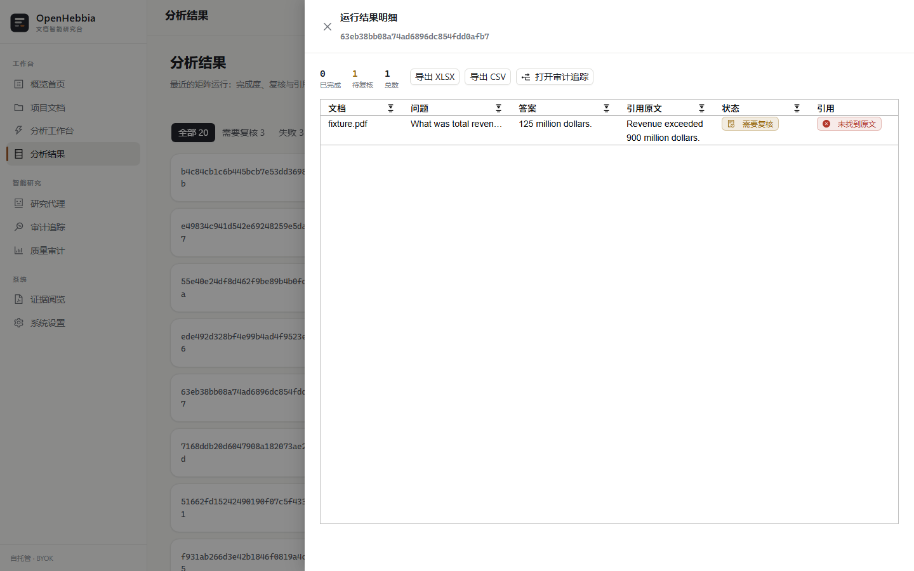
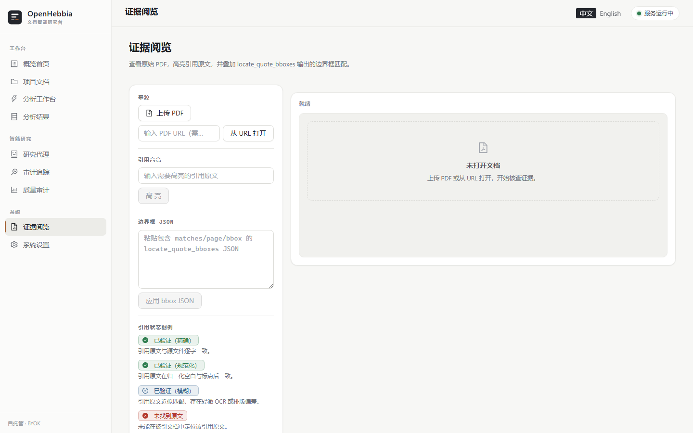
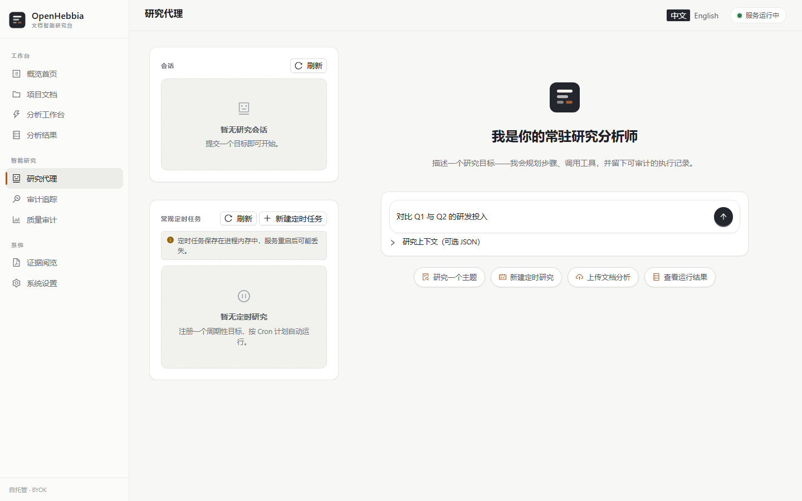

# OpenMatrix

**一个自托管、证据优先的 AI 研究工作台，让每个重要结论都能回到可核验的原始证据。**

中文 | [English](README.md)

> **独立开源项目声明：**OpenMatrix 是一个独立的自托管开源项目（Apache-2.0），与任何商业金融 AI 厂商均不存在官方关联、背书或维护关系。

[](LICENSE)


OpenMatrix 可以把财报、公告、研究文档与公开数据转换为**可复核的研究成果**，并保留原文逐字引用、物理页码、答案支持度校验与可观察的执行轨迹。

它面向那些“模型回答看起来顺畅”远远不够的专业研究场景。分析人员需要明确知道：

- **这个结论出自哪一份文档的第几页？**
- **引文是否真正支持答案中的数字与口径（而不仅仅是原文里有这句话）？**
- **哪一步执行失败了、哪些内容仍需人工复核？**
- **结果能否直接导出为干净的报告、表格或带引文脚注的幻灯片？**

> **发布状态（`v0.1.0` Public Preview）：**适用于本地评估、自托管团队试点与 MCP 工作流编排。部署到内网或公网前，请阅读[安全策略](SECURITY.md)与[专利与合规声明](#专利与合规声明)。



_截图来自使用演示数据的本地验证环境。界面中的单元格数量和验证率不代表客户数据或产品整体准确率承诺。_

## 为什么选择 OpenMatrix

大多数 AI 文档工具只优化“生成更多看似合理的文字”。OpenMatrix 专注生成**可以被逐条检查、追溯和交付的研究成果**。

### 先有证据，再谈置信度

每条回答均可携带原文引用、来源文档、物理页码、引文匹配状态（`verified_exact` / `verified_normalized` / `verified_fuzzy` / `not_found`）以及**答案支持度评估**（`supported` / `partial` / `unsupported`）。缺少引用或数值不符的结论会自动标为 `needs_review`，而不是包装成确定事实。

### 推荐的无网格研究工作流

针对多文档对比与常规研报分析，OpenMatrix 默认推荐无网格的 **「文档列表 + 独立结构化 Q&A + 证据汇总」** 路径（MCP / API 中的 `analyze_documents` 与 Research Agent 工作台）：

- 创建文档项目、跨来源检索、运行受边界控制的 Agent 任务、点击引用一键跳回 PDF 对应页高亮，并一键导出为 CSV、XLSX、PDF、DOCX 或 PPTX。

### 自托管与自带模型（BYOK）

支持完全本地或私有化运行，兼容任意 OpenAI 协议接口（OpenAI、DeepSeek、本地 `vLLM` / `llama.cpp` 或内网模型网关）。模型 API Key 仅由用户在运行时按次传入内存，前端浏览器不会持久化存储密钥。

### 对系统边界保持诚实

OpenMatrix 明确区分 `completed`、`failed`、`unavailable` 与 `needs_review` 状态；当后端未能生成对应数据时，界面绝不编造结论、伪造推理过程或虚假进度条。

## 适用场景

- 阅读上市公司 10-K / 年报、公告与监管披露文件
- 带单位/量级归一化（thousands / millions）与表头年份过滤的财务 KPI 提取
- 多份文档间的观点对比与矛盾检测
- 生成带原文证据链与页码追溯的研究备忘录
- 一键导出 CSV、XLSX、PDF、DOCX 或带页脚逐字引文的 PPTX 幻灯片
- 通过 REST API 或 52 个 MCP 工具编排可复用的研究任务

### 希望参与受控试点？

欢迎在 [GitHub Issues](https://github.com/xw371242806-afk/openmatrix/issues) 中使用 **Pilot** 模板提交 `Pilot: <你的工作流>`。请勿在公开 Issue 中上传机密文件、API 密钥、个人隐私或受监管数据。

## 研究工作流

```text
文档与公开数据源（PDF / DOCX / TXT / SEC EDGAR / AkShare / FRED）
        ↓
解析并保留物理页码、索引与检索（BM25 / 可选混合检索）
        ↓
结构化分析与有边界 Agent 编排（52 个 MCP 工具）
        ↓
逐字引文校验 + 答案支持度校验（数字与实体一致性核对）
        ↓
PDF 证据查看器（跳页高亮定位）& 执行审计轨迹
        ↓
多格式交付（CSV / XLSX / PDF / DOCX / 带引用脚注 PPTX）
```

## 产品界面导览

### 启动前进行明确的就绪检查

选择文档、配置提取问题与模型端点，确认执行范围与参数就绪后再启动。



### 检查答案与支持度，而不是盲信黑盒

在一个工作区内同时查看运行状态、引用原文、答案支持度信号、物理页码和导出选项。



### 一键跳回原始 PDF 页面定位高亮

通过证据查看器核对原始页面、逐字引文、验证状态及坐标高亮位置。



### 追踪 Research Agent 的真实执行步骤

运行受步数与超时限制的研究任务，查看每一步工具调用状态；未产生的数据保持明确不可用。



## 核心能力矩阵

| 领域 | 当前可用能力与边界 |
|---|---|
| 文档解析 | **默认可用：**PDF 多文档解析、`pypdf` / `pdfplumber` 物理页保留、DOCX/TXT 上传。**可选配置：**Camelot 表格抽取、OCRmyPDF / PaddleOCR |
| 检索与召回 | **默认可用：**页码感知 BM25（`bm25s`）+ 金融术语查询扩展。**可选配置：**稠密/混合检索与重排 |
| 引用与核验 | 精确/归一化/模糊引用匹配、上标脚注附近引文定位、`assess_answer_support` 答案支持度校验、`extract_kpis` 量级归一化 |
| Agent 与 MCP | 52 个 FastMCP 工具、规则规划器、可选 LLM 规划器（`OPENMATRIX_LLM_PLANNER`）、可中断 `research_run`、SQLite 持久化定时任务 |
| 数据连接器 | **免密钥默认：**SEC EDGAR（自动匹配年报 FY XBRL 与 `www.sec.gov/Archives` 原文）、项目文档、SSRF 加固 URL 抓取。**可选：**AkShare、FRED、Web 检索 |
| 交付导出 | **REST 与界面：**CSV、XLSX、PDF、DOCX、PPTX。**MCP 工具：**`export_report`、`export_slides`（每页含原文引文脚注） |
| 存储后端 | **默认：**SQLite + 本地磁盘（`data/`）。**可选生产后端：**PostgreSQL（`psycopg`）+ S3/MinIO（`boto3`） |
| 安全护栏 | `OPENMATRIX_ENABLE_AUTH=auto`（非回环地址自动启用 Bearer 鉴权与 `master_key.txt`）、严格 CORS、日志密钥脱敏、SSRF IP 钉扎、流式上传限额 |

更多详情请查看 [文档索引](docs/README.md)、[MCP 客户端指南](docs/MCP-CLIENTS.md)、[MCP 路线图](docs/MCP-ROADMAP.md) 与 [安全策略](SECURITY.md)。

## 快速开始

### Docker（推荐）

默认 Docker Compose 仅绑定 `127.0.0.1` 回环地址，并使用 SQLite 与本地磁盘卷（`openmatrix-data`），无需额外配置数据库：

```bash
docker compose up --build
```

浏览器打开：

```text
http://localhost:8000/ui/
```

当绑定非回环地址（如容器内的 `0.0.0.0`）时，访问鉴权会自动开启，可通过以下命令查看自动生成的 Master Key：

```bash
docker compose exec app cat /data/master_key.txt
```

### 本地开发

环境依赖：Python 3.12+、Node.js 24+

构建前端 Research Desk：

```bash
cd ui
npm ci
npm run build
cd ..
```

macOS / Linux 启动：

```bash
python -m venv venv
./venv/bin/python -m pip install -r requirements.txt -c requirements.lock
./venv/bin/python main.py
```

Windows PowerShell 启动（也可直接双击 `start.bat` 或运行 `setup_windows.ps1` 一键缓存启动）：

```powershell
python -m venv venv
.\venv\Scripts\python.exe -m pip install -r requirements.txt -c requirements.lock
.\venv\Scripts\python.exe main.py
```

随后访问 `http://localhost:8000/ui/`（旧版零依赖单页原型仍可通过 `http://localhost:8000/static/index.html` 访问）。

## 模型接入

OpenMatrix 支持连接任意 OpenAI 兼容接口（云端 API、自建 `vLLM` / `llama.cpp` / Ollama 或团队内部 API 代理）。密钥可通过前端界面按次输入（仅存内存），或通过环境变量 `OPENMATRIX_LLM_API_KEY`、`OPENMATRIX_LLM_BASE_URL` 配置。支持按任务路由不同模型（`OPENMATRIX_ROUTER_ENABLED`）。

## 测试与验证

```bash
# 后端全量测试
python -m pytest -q

# 前端测试、Lint 与构建
cd ui && npm test && npm run lint && npm run build

# 服务端到端冒烟验证（需先启动服务在 127.0.0.1:8000）
python scripts/verify_running_service.py
```

## 专利与合规声明

OpenMatrix 基于 [Apache License 2.0](LICENSE) 开源发布。开源许可证仅授予项目代码本身的版权与贡献者专利授权，**不构成**针对第三方专利的自由实施（FTO）法律意见。

- 在多文档分析场景下，OpenMatrix 推荐优先采用无网格的 **`analyze_documents`**（文档列表 + 独立问答 + 证据汇总）工作流，且代码库**严格不包含**基于 token attention 分数的 cell 高亮机制。
- 仓库保留了多文档矩阵式表格视图供本地评估使用；若计划在商业 SaaS 生产环境（尤其是美国司法辖区）部署相关矩阵交互界面，请提前结合现行代码咨询专业知识产权律师。技术合规护栏详见 [PATENT_COMPLIANCE.md](PATENT_COMPLIANCE.md)。

## 参与贡献与许可证

欢迎提交 Issue 与 Pull Request，请先阅读 [CONTRIBUTING.md](CONTRIBUTING.md)、[CODE_OF_CONDUCT.md](CODE_OF_CONDUCT.md)、[SECURITY.md](SECURITY.md) 与 [THIRD_PARTY_NOTICES.md](THIRD_PARTY_NOTICES.md)。本项目采用 [Apache License 2.0](LICENSE) 开源。
